### about

- building **lol cards**, a league of legends card collecting bot for discord
- brazil

### lol cards

a discord bot for collecting league of legends champion and skin cards. 2,100+ cards straight from the game's data.

- rolls, a weekly gacha banner and rare special edition cards with holographic frames
- mastery forge, skin line albums, trades and server leaderboards

### stack

### contributions

<picture>
  <source media="(prefers-color-scheme: dark)" srcset="https://raw.githubusercontent.com/imspiritttt/imspiritttt/snake/snake-dark.svg" />
  
</picture>

lol cards isn't endorsed by riot games and doesn't reflect the views or opinions of riot games or anyone officially involved in producing or managing riot games properties.
